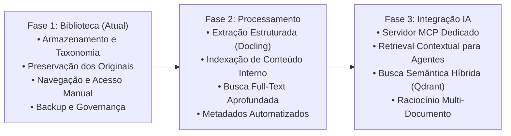

# Biblioteca de Documentos Brutos

> **Espaço**: Enki Engine / Conhecimento  
> **Identificador**: `DOC-RAW-LIB-001`  
> **Status**: Ativo (Fase 1 — Biblioteca)  
> **Última Atualização**: 21 de Outubro de 2026  
> **Responsável**: Engenharia / Documentação Enki Engine  

---

## 1. Visão Geral

A **Biblioteca de Documentos Brutos** é o repositório centralizado de arquivos originais utilizados, gerados e consultados durante todo o ciclo de desenvolvimento do **Enki Engine**. 

Seu objetivo primordial é **preservar a integridade, o formato nativo e a proveniência original** dos artefatos do projeto, assegurando rastreabilidade técnica, reprodutibilidade de decisões e uma base sólida para consulta manual por membros da equipe técnica e stakeholders autorizados.

> [!IMPORTANT]
> **Escopo da Fase Atual (Fase 1 — Biblioteca)**:
> A prioridade absoluta nesta fase é o **armazenamento seguro, organização categórica e preservação fiel dos arquivos originais**. Não há processamento automatizado de documentos, geração de embeddings, vetorização ou consumo automático por IA em execução nesta etapa. Tais capacidades pertencem ao roadmap planejado para as Fases 2 e 3.

---

## 2. Tipos de Documentos Suportados

A biblioteca acolhe os diversos formatos produzidos e coletados na engenharia do Enki Engine:

- **Documentos Textuais e Wikis**: Markdown (`.md`), HTML (`.html`);
- **Documentos de Escritório**: Word (`.docx`), Apresentações (`.pptx`);
- **Formatos Tabulares e Dados**: Planilhas (`.xlsx`), CSV (`.csv`), JSON (`.json`);
- **Documentos Portáteis e Leitura**: PDFs técnicos (`.pdf`), relatórios diagramados;
- **Pacotes e Evidências**: Arquivos compactados (`.zip`, `.tar.gz`) contendo logs brutos, traces ou bundles de assets;
- **Relatórios Técnicos e de Pesquisa**: Especificações de arquitetura, RFIs, RFPs, logs de benchmarks e evidências de execução de testes.

---

## 3. Organização dos Documentos e Estrutura Lógica

No modelo arquitetural do Enki Engine, a biblioteca organiza-se em **oito categorias funcionais padronizadas**. 

### 3.1 Categorias Padronizadas

| Categoria | Caminho Lógico | Descrição e Tipos de Conteúdo |
| :--- | :--- | :--- |
| **Pesquisa** | `research/` | Levantamentos bibliográficos, benchmarks comparativos de mercado, estudos de viabilidade e investigações prévias. |
| **Arquitetura** | `architecture/` | Diagramas de sistemas, Decisões de Arquitetura (ADRs), especificações de infraestrutura e contratos de API. |
| **Planejamento** | `planning/` | Roadmaps, cronogramas de sprints, planos de implementação de funcionalidades e matrizes de dependência. |
| **Execução** | `execution/` | Registros de deploy, logs de testes end-to-end, relatórios de verificação e evidências operacionais de execução. |
| **Relatórios** | `reports/` | Relatórios de status executivo, auditorias periódicas, sumários de custos e relatórios de desempenho. |
| **Técnico** | `technical/` | Especificações detalhadas de componentes, manuais internos de configuração, esquemas de dados e guias de referência técnica. |
| **Referências** | `references/` | Manuais de fornecedores externos, normas técnicas (e.g. NIST, OWASP, ISO), artigos acadêmicos e referências legais. |
| **Arquivo Histórico** | `archive/` | Versões obsoletas de planos, propostas descontinuadas, artefatos legados mantidos apenas para histórico e auditoria. |

> [!NOTE]
> **Tradução da Estrutura Lógica para o Docmost**:
> Os caminhos lógicos listados acima (ex: `architecture/`, `research/`) representam a **taxonomia lógica documental**, e não diretórios físicos soltos no servidor. No Docmost, cada categoria deve ser representada como uma **Página-Mãe (Subseção)** dentro do Espaço principal do Enki Engine, sob a qual os documentos correspondentes são cadastrados como subpáginas ou anexos com metadados.

---

## 4. Limitações Reais da Plataforma Docmost para Arquivos Brutos

Para garantir o uso consistente e evitar expectativas incompatíveis com a ferramenta, registram-se as características e restrições reais da plataforma Docmost:

1. **Natureza Wiki/Documental vs. Gerenciador de Arquivos**: O Docmost é uma base de conhecimento e wiki estruturada, e **não um gerenciador de arquivos genérico** (como Nextcloud, S3 Browser ou servidor SFTP/WebDAV). Ele não provê uma interface de navegação em árvore de pastas arbitrárias de sistema de arquivos.
2. **Tratamento de Páginas vs. Anexos**:
   - Arquivos `.md`, `.docx` e `.html` contam com importação nativa pelo menu de páginas do Espaço, sendo convertidos em páginas wiki ricas.
   - Arquivos `.pdf`, `.xlsx`, `.pptx`, `.csv` e `.zip` **não são convertidos em páginas**. Eles devem ser inseridos como **anexos (attachments)** dentro de uma página de catálogo/contexto ou vinculados em blocos do editor TipTap. O arquivo binário original é mantido intacto no volume de dados, mas não possui navegação própria fora do contexto da página.
3. **MIME Types e Importação**: Importações em lote via ZIP ou uploads manuais de `.md` podem, em determinadas distribuições, ser interpretados como `text/plain` em vez de `text/markdown`. É recomendável verificar a renderização após a inclusão.
4. **Escopo de Permissões**: Na versão comunitária open-source do Docmost, as permissões de acesso são atribuídas no nível de **Espaço (Space)**. O isolamento de páginas individuais (`Page-level permissions`) é restrito às edições comerciais (Business/Enterprise). Portanto, se um documento exigir restrição estrita de visualização, ele deve ser alocado em um Espaço com permissão restrita.
5. **Busca Full-Text**: A busca nativa do Docmost (baseada no PostgreSQL) indexa o texto contido nas **páginas**. Conteúdos textuais internos de arquivos binários anexados (como um PDF não convertido ou uma planilha `.xlsx`) não são indexados na busca global nesta Fase 1.

---

## 5. Regras Fundamentais de Armazenamento

Todos os colaboradores e sistemas que operam a Biblioteca de Documentos Brutos devem seguir rigorosamente as oito regras de governança documental:

1. **Preservação do Original**: O arquivo fonte deve ser armazenado sem adulteração de conteúdo, formatação ou estrutura.
2. **Proibição de Conversão Automática Destrutiva**: Não converter documentos brutos para formatos proprietários ou simplificados durante o arquivamento. Se for gerada uma página wiki a partir de um `.docx` ou `.md`, o arquivo original de upload deve ser preservado como anexo de referência.
3. **Nomenclatura Semântica e Extensões**: Manter nomes descritivos padronizados em *kebab-case* ou *snake_case*, contendo prefixo temporal ou temático e extensão explícita compatível com o formato real (ex: `2026-10-21_arch_enki_gateway_spec.docx`).
4. **Eliminação de Duplicatas**: Não subir repetidamente o mesmo binário idêntico. Se uma nova versão for criada, deve-se versionar o registro explicitamente.
5. **Registro de Origem e Contexto**: Nenhum documento deve ser arquivado como "órfão". Cada inclusão deve registrar o autor/origem, a data de obtenção e o objetivo técnico do arquivo.
6. **Imutabilidade e Restrição de Exclusão**: É expressamente vedado excluir ou sobrescrever materiais existentes sem autorização formal do responsável de documentação. Versões superadas devem ser marcadas como `obsoleto` e migradas logicamente para `archive/`.
7. **Persistência e Backup**: Todos os arquivos devem residir em volumes persistentes do sistema de armazenamento, cobertos por rotinas automatizadas de backup e retenção cíclica.
8. **Privacidade e Acesso Autorizado**: Nenhum documento interno do Enki Engine deve ser marcado com visibilidade pública ou exposto externamente sem aprovação formal prévia.

---

## 6. Modelo Padronizado de Metadados

Para cada documento bruto armazenado no Docmost, deve-se registrar manualmente um bloco de metadados padronizado na página que abriga ou anexa o artefato.

### 6.1 Formato em Bloco Frontmatter (Recomendado para Páginas Markdown)

```yaml
---
document_id: "RAW-ARCH-2026-004"
title: "Especificação Técnica do Enki Gateway"
category: "architecture"
component: "enki-research-gateway"
source: "Equipe de Engenharia / Samuel Antunes"
inclusion_date: "2026-10-21"
version: "1.0.0"
status: "ativo" # ativo | historico | obsoleto
description: "Documento com a modelagem de endpoints, cache SearXNG e controle de cotas Brave/Tavily."
original_filename: "2026-10-21_enki_gateway_spec_v1.docx"
file_format: "docx"
---
```

### 6.2 Formato em Tabela Visual (Para Edição no Editor Visual TipTap)

| Metadado | Descrição / Valor |
| :--- | :--- |
| **Nome do Documento** | Especificação Técnica do Enki Gateway |
| **Identificador / Versão** | `RAW-ARCH-2026-004` / v1.0.0 |
| **Categoria Lógica** | `architecture/` |
| **Componente Relacionado** | `enki-research-gateway` |
| **Origem / Autor** | Equipe de Engenharia |
| **Data de Inclusão** | 21/10/2026 |
| **Status** | **Ativo** |
| **Descrição Breve** | Especificação com a modelagem de endpoints, quotas e cache do Gateway. |
| **Arquivo Anexo Original** | `[2026-10-21_enki_gateway_spec_v1.docx]` *(Anexo)* |

---

## 7. Procedimentos de Utilização Operacional

### Procedimento A: Como Adicionar um Novo Documento

1. **Navegar até a Categoria**:
   - Abra o Docmost em `https://docs-int.enkiengine.com`.
   - Acesse o Espaço **Enki Engine**.
   - Na barra lateral esquerda, localize e abra a subseção correspondente (ex: `architecture/`).
2. **Criar a Página ou Importar**:
   - **Caso `.md` ou `.docx` estruturado**: Clique no menu de opções (`...`) da subseção > `Import pages` e selecione o arquivo. A plataforma criará uma página com o conteúdo renderizado.
   - **Caso `.pdf`, `.xlsx`, `.pptx` ou `.zip`**: Clique em `New Page` dentro da subseção. Atribua o título correspondente ao artefato.
3. **Registrar os Metadados e Anexar**:
   - Insira o bloco de metadados padronizado (tabela ou YAML) no topo da página.
   - Arraste ou anexe o arquivo original intacto no corpo da página utilizando o bloco de anexo de arquivo do editor.
4. **Publicar**:
   - Clique em `Publish` para salvar a versão inicial.

### Procedimento B: Como Consultar e Recuperar Documentos

1. **Localização**:
   - Navegue pela árvore hierárquica do Espaço até a categoria desejada ou utilize o atalho de busca global (`Ctrl + K` / `Cmd + K`) pesquisando pelo identificador ou descrição cadastrada no metadado.
2. **Download / Leitura**:
   - Acesse a página do documento.
   - Para arquivos convertidos: leia diretamente no navegador.
   - Para arquivos binários anexados: clique no card do anexo para realizar o download direto do binário original intocado.

### Procedimento C: Como Atualizar ou Arquivar um Material

1. **Atualização**:
   - Não substitua ou apague o anexo da versão anterior sem necessidade de histórico.
   - Adicione uma nova linha na seção de versões da página com o novo anexo (ex: `v1.1.0`), especificando as alterações no campo de descrição e mantendo o histórico de versões acessível no Docmost.
2. **Arquivamento**:
   - Altere o status no metadado de `ativo` para `historico` ou `obsoleto`.
   - Arraste a página na árvore lateral para dentro da seção `archive/` correspondente.

---

## 8. Roadmap de Evolução da Plataforma

O planejamento arquitetural da biblioteca está dividido em três etapas claras:



### Fase 1 — Biblioteca (Fase Atual)
- Organização e estruturação categórica documental;
- Armazenamento íntegro dos arquivos originais;
- Navegação manual, catalogação visual e recuperação via Docmost;
- Políticas de retenção, backup e controle de acesso no Espaço.

### Fase 2 — Processamento (Etapa Futura)
- Pipeline de extração estruturada de conteúdo multi-formato (utilizando motor determinístico como Docling);
- Indexação do conteúdo textual completo extraído de PDFs, planilhas e apresentações;
- Busca textual integrada abrangendo o interior dos anexos;
- Extração automatizada de metadados e sumários.

### Fase 3 — Integração com Agentes de IA (Etapa Futura)
- Implementação de Servidor MCP (Model Context Protocol) para consulta automatizada;
- Ferramentas nativas expostas a agentes para listar, filtrar e inspecionar documentos brutos;
- RAG semântico híbrido com vetorização local via Ollama / Qdrant quando justificado por volume de dados;
- Citação auditável e rastreabilidade formal documento-código.

---
*Documento homologado para implantação no Espaço do Enki Engine no Docmost.*
