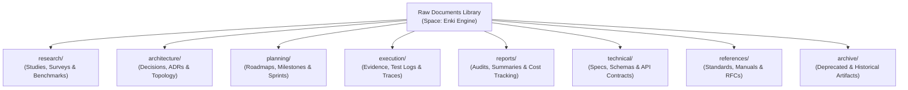
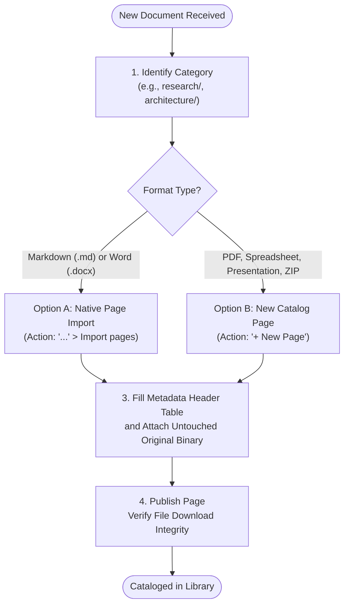

# Raw Documents Library

> **Space**: Enki Engine  
> **Document Code**: `DOC-RAW-LIB-001`  
> **Status**: Active (Phase 1 — Library)  
> **Last Updated**: October 21, 2026  
> **Owner**: Enki Engine Technical Documentation & Governance Team  

---

## 1. Overview

The **Raw Documents Library** serves as the centralized single source of truth for all original, unmodified source files collected, created, and referenced throughout the development lifecycle of the **Enki Engine**.

Its primary objective is the **uncompromised preservation of format integrity, native structure, and provenance context**. By archiving documents in their original state, the project guarantees historical auditability, reproducibility of technical decisions, and a reliable foundation for manual engineering review.

> [!IMPORTANT]
> **Operational Scope for Current Phase (Phase 1 — Library)**:
> In this foundational phase, priority is strictly placed on **secure storage, structured classification, and strict preservation**. **No automated AI extraction, embedding generation, semantic vectorization, or autonomous agent consumption is active at this stage**. These automated capabilities are explicitly scheduled for Phases 2 and 3.

---

## 2. Accepted Document Formats

The Raw Documents Library accommodates all engineering formats produced across Enki Engine subsystems:

- **Plain Text & Wikis**: Markdown (`.md`), HTML (`.html`);
- **Office & Documents**: Word Documents (`.docx`), Presentations (`.pptx`);
- **Tabular & Structured Data**: Spreadsheets (`.xlsx`), Comma-Separated Values (`.csv`), Structured Schemas (`.json`);
- **Portable & Diagram Documents**: Technical PDFs (`.pdf`), exported architectural diagrams, schematics;
- **Compressed Archives & Evidence**: Zip files (`.zip`, `.tar.gz`) containing raw execution logs, traces, memory dumps, or asset bundles;
- **Engineering Reports**: Benchmark summaries, Request for Comments (RFCs), verification logs, and compliance records.

---

## 3. Logical Document Organization (8 Standardized Categories)

Document organization follows an eight-category conceptual taxonomy reflecting Enki Engine's engineering pillars:



### 3.1 Taxonomy Dictionary

| Category | Logical Path | Scope and Purpose | Typical Artifacts |
| :--- | :--- | :--- | :--- |
| **Research** | `research/` | State-of-the-art surveys, feasibility evaluations, market comparisons, and literature reviews. | Search engine benchmarks, model evaluation papers, algorithm studies. |
| **Architecture** | `architecture/` | Architecture Decision Records (ADRs), system topology diagrams, infrastructure blueprints, and service boundaries. | C4 model diagrams, gateway specs, network isolation policies. |
| **Planning** | `planning/` | Project roadmaps, release schedules, sprint milestones, and risk matrices. | Milestone execution plans, backlog plans, dependency trackers. |
| **Execution** | `execution/` | Empirical runtime verification, E2E test runs, container deployment logs, and operational traces. | Test suite execution traces, CLI outputs, automated benchmark logs. |
| **Reports** | `reports/` | Executive summaries, security audits, quota usage analyses, and periodic cost evaluations. | OCI cloud billing breakdowns, API quota usage reports, bi-weekly status reports. |
| **Technical** | `technical/` | Component specifications, configuration manuals, database schemas, and interface definitions. | JSON Schemas, environment variable dictionaries, protocol contracts. |
| **References** | `references/` | External regulatory frameworks (NIST, OWASP, ISO), vendor API manuals, and academic RFCs. | OWASP ASVS checklists, RFC 3986 references, vendor SDK specifications. |
| **Archive** | `archive/` | Superseded designs, abandoned proposals, and legacy documents preserved strictly for audit compliance. | Deprecated architecture proposals, legacy roadmap revisions. |

> [!NOTE]
> **Mapping Logical Taxonomy to Docmost**:
> The folder notation above (`research/`, `architecture/`, etc.) represents a **logical classification taxonomy**. In Docmost, documents are natively structured as **Spaces** and **Hierarchical Pages**. Within the `Enki Engine` Space, each logical category is represented as a top-level parent page, under which individual document catalog pages or imported wiki subpages reside.

---

## 4. Real Platform Characteristics & Limitations of Docmost

To maintain alignment between engineering workflows and platform capabilities, the following operational realities of Docmost are documented:

1. **Wiki vs. Generic File Manager**: Docmost is a modern, collaborative documentation wiki. It is **not a generic network drive, WebDAV share, or S3 bucket browser**. It does not offer arbitrary operating system folder trees or direct SFTP browsing. All raw files must be contextualized inside pages or subpages.
2. **Page Import vs. Binary Attachments**:
   - Files formatted in `.md`, `.docx`, and `.html` can be imported directly via the Space's `Import pages` dialog, transforming their text into rich, interactive wiki pages.
   - Binary and tabular files (`.pdf`, `.xlsx`, `.pptx`, `.csv`, `.zip`, `.tar.gz`) **are not converted into wiki pages**. They must be uploaded as **page attachments** inside a dedicated catalog page that provides the necessary context and metadata.
3. **Open-Source Permission Scope**: In the community edition of Docmost, access control is enforced at the **Space level**. Granular per-page permissions (`Page-level permissions`) are restricted to commercial enterprise tiers. If specific materials require restricted access, they should be partitioned into a dedicated restricted Space.
4. **Native Full-Text Search Boundaries**: Docmost's built-in PostgreSQL full-text search indexes the text contained in the **body of wiki pages**. It does not parse or index text embedded inside binary attachments (such as scanned PDFs or Excel sheets) in this initial Phase 1.

---

## 5. Fundamental Storage Governance Rules

All users, administrators, and contributors must strictly adhere to the eight core governance rules:

1. **Preserve Originals**: Always archive files in their original, unedited source format, preserving native structure and file properties.
2. **No Lossy Auto-Conversion**: Do not destructively convert raw uploads. If a wiki page is created from a `.docx` or `.md` source, the original binary file must remain attached as the ground-truth reference.
3. **Semantic Naming & Correct Extensions**: File names must be descriptive and follow standardized kebab-case or snake_case formats with timestamps (e.g., `YYYY-MM-DD_category_document-name.ext`), avoiding spaces or unsupported special characters.
4. **Prevent Duplication**: Verify whether a file already exists before uploading. Updated contents must be managed through versioning rather than parallel duplicate uploads.
5. **Context & Provenance Tracking**: No orphaned documents are permitted. Every document must clearly record its author/source, date of origin, and engineering rationale.
6. **No Arbitrary Deletion**: Deleting documents is strictly prohibited. Superseded materials must be marked as `deprecated` and logically reclassified into `archive/`.
7. **Persistent Storage & Regular Backups**: Storage volumes (`docmost_data` and PostgreSQL `db_data`) must reside on persistent storage backed by automated backup and snapshot routines.
8. **Restricted Confidentiality**: The library is restricted to internal team members. No page or attachment may be published to external or public viewers without explicit management authorization.

---

## 6. Standardized Metadata Schema

Every document cataloged in the Raw Documents Library must feature a standardized metadata header.

### 6.1 Frontmatter YAML Schema (Recommended for Markdown Imports)

```yaml
---
document_id: "RAW-ARCH-2026-001"
title: "Enki Research Gateway Architecture Specification"
category: "architecture"
related_component: "enki-research-gateway"
source_author: "Engineering Team / Samuel Antunes"
inclusion_date: "2026-10-21"
version: "1.0.0"
status: "active" # active | historical | deprecated
description: "Core technical specification for SearXNG caching, rate-limiting, and quota management."
original_filename: "2026-10-21_enki_gateway_spec_v1.docx"
file_format: "docx"
---
```

### 6.2 Visual Metadata Table (For Visual Editing in TipTap Editor)

| Metadata Field | Required | Description / Value | Example Value |
| :--- | :---: | :--- | :--- |
| **Document Name** | Yes | Full human-readable document title. | SearXNG Benchmarking Report |
| **Document ID** | Yes | Standardized category-prefixed identifier. | `RAW-RES-2026-002` |
| **Logical Category** | Yes | Standardized category designation. | `research/` |
| **Related Subsystem** | Yes | Associated Enki Engine module or repository. | `enki-searxng` / `enki-research` |
| **Author / Source** | Yes | Originating team, engineer, or vendor source. | Samuel Antunes / Enki Infrastructure |
| **Inclusion Date** | Yes | Date of cataloging in ISO format (`YYYY-MM-DD`). | `2026-10-21` |
| **Version** | Yes | Semantic version or revision code. | `v1.0.0` |
| **Status** | Yes | Lifecycle state: `active`, `historical`, or `deprecated`. | **Active** |
| **Brief Summary** | Yes | 2–3 line summary outlining purpose and content. | Latency, throughput, and memory consumption metrics under concurrent queries. |
| **Raw Attachment** | Yes | Attached binary file preserved in original state. | `[2026-10-21_searxng_bench.xlsx]` *(Attachment)* |

---

## 7. Step-by-Step Operational Procedures



### Procedure A: Adding a New Document
1. **Access Space**: Open Docmost at `https://docs-int.enkiengine.com` and select the **Enki Engine** Space.
2. **Select Target Category**: Navigate through the sidebar hierarchy to locate the corresponding category parent page (e.g., `technical/`).
3. **Import or Create Page**:
   - For `.md` or `.docx` files: Click the `...` menu on the category parent page, select `Import pages`, choose the file, and complete the import.
   - For `.pdf`, `.xlsx`, `.pptx`, or `.zip` files: Click `+ New Page` under the category parent page and assign the descriptive document title.
4. **Attach Metadata & Binary**:
   - Place the standardized metadata table at the very top of the page body.
   - Attach the original raw binary file using the editor's file attachment block.
5. **Publish**: Click `Publish` in the top right corner.

### Procedure B: Searching and Downloading Documents
1. **Fast Search**: Press `Ctrl + K` (or `Cmd + K` on macOS) and search by document ID (e.g., `RAW-RES-2026-002`) or keywords present in the title and description.
2. **Hierarchical Navigation**: Expand the category tree in the left sidebar to browse categorized materials.
3. **Direct Download**: Open the catalog page and click on the attachment block to initiate a direct download of the untouched source binary.

### Procedure C: Updating and Archiving Records
1. **Versioning**:
   - Never delete or overwrite previous attachments.
   - Add a new row to the revision table on the page, attach the new file version (e.g., `v1.1.0`), and document the changes.
2. **Archiving**:
   - When a document is superseded, change its metadata status to `deprecated`.
   - In the sidebar, drag the catalog page under the `archive/` parent page to preserve historical traceability without cluttering active sections.

---

## 8. Evolution Roadmap

The Raw Documents Library follows a structured 3-phase evolutionary roadmap:

| Phase | Milestone | Core Capabilities | Underlying Technologies |
| :---: | :--- | :--- | :--- |
| **Phase 1** | **Library (Current)** | • Manual categorization across 8 logical categories.<br>• Unmodified preservation of source binaries.<br>• Hierarchical navigation and page-level full-text search.<br>• Backup, retention, and access governance. | Docmost Core, PostgreSQL 16, Redis 7.2, Persistent Volumes. |
| **Phase 2** | **Processing (Future)** | • Deterministic multi-format text extraction (PDF, DOCX, XLSX, PPTX).<br>• Deep full-text indexing of attachment contents.<br>• Automated metadata extraction and document summarization. | IBM Docling extraction sidecar, search indexing workers. |
| **Phase 3** | **AI & MCP (Future)** | • Dedicated Model Context Protocol (MCP) server integration.<br>• Agent tools to list, inspect, and retrieve raw documents.<br>• Hybrid semantic vector search across engineering knowledge.<br>• Automated document-to-code traceability. | Docmost REST API, MCP Server, Qdrant Vector DB, Local Ollama Models. |

---
*Official documentation page for Enki Engine Knowledge Platform.*
